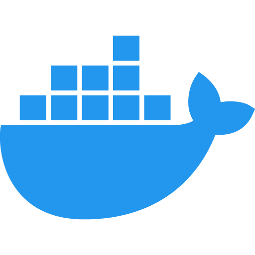
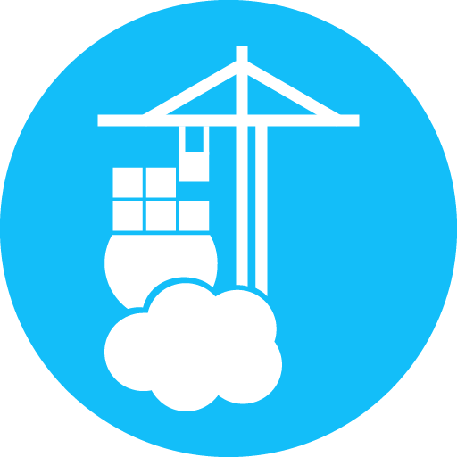
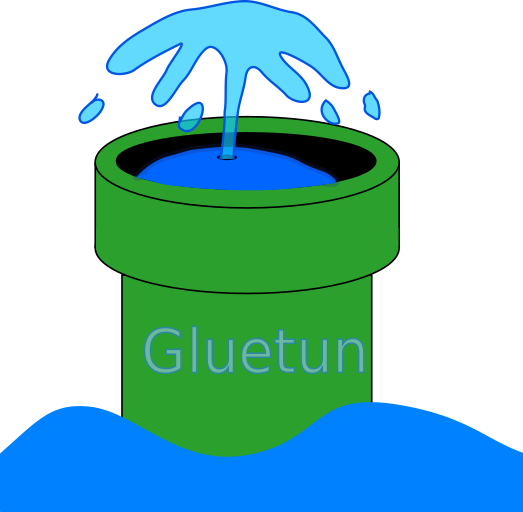

# 🖥️ Welcome to Homestack Wiki

This wiki is aimed at the home enthusiast for HomeLab servers setup.

## ⚠️ Disclaimer
All information contained within this document or resource is provided strictly for educational purposes only. It is not intended to constitute, nor should it be relied upon as, professional advice, including but not limited to financial, legal, medical, or investment counsel. The content is based on general knowledge and publicly available data as of the date of creation and may not reflect the most current developments or individualized circumstances.
No warranty, express or implied, is made regarding the accuracy, completeness, reliability, or suitability of the information provided. The authors, publishers, and distributors disclaim any and all liability arising from the use of or reliance on this material, including but not limited to any errors, omissions, or consequences resulting therefrom. Users are encouraged to consult qualified professionals for advice tailored to their specific situations and to verify all information independently.
By accessing or using this content, you acknowledge and agree to these terms.

# 🖥️ [FORUMS](https://forums.thehomestack.io/)
Use our NEW [forums](https://forums.thehomestack.io/) forums for any questions you may have from this site.

## Start Here
New to self-hosting? Start here:

▶️ **pfSense**
▶️ **Linux**
▶️ **[Synology](/synology)**
▶️ **[ArcLoader Synology](/synology)**
▶️ **[Docker](/docker)

▶️ **[Docker Homelab Stacks](/docker-stacks)****
▶️ **[Portainer](/portainer)**

## Knowledge Basis

###  Synology EcoSystem
| Guide | Description |
|-------|-------------|
| [📁 Docker Folder Setup](/dockerfolders) | Prepare for Docker
| [📦 Application Setup]() | Add swag to Synology

###  Servarr EcoSystem
| Guide | Description |
|-------|-------------|
| [📁 Servarr Folder Setup]() | Prepare for ARR MediaStack

#  Linux EcoSystem 

## Admin Scripts
[Linux & Docker Admin Scripts](https://docs.thehomestack.io/books/linux-docker-admin-scripts): practical shell scripts and how-tos for monitoring, backups, scheduled jobs, certificates and media-library housekeeping, on our documentation site.

## 🫙 Containerized
[Install Docker](/docker)
[Install Portainer](/portainer)

### 🖥️ Self-Hosting MediaStack (must have)
[ Plex Setup](/plex)
[ Jellyfin Setup](/jellyfin)
[ Seerr Setup](/seerr)

### 🖥️ Self-Hosting ImageStack
[ Immich Photo Management](/immich)

## 🌐 Media Access🛡️Security
Make sure you configure a VPN 
[ Proton VPN](https://protonvpn.com/)
[ Gluetun Tunnel](/gluetun)

## 🌐 Firewall / Networking
 pFsense

# 🌟 Favorites

🔥:office: Office Lab Equipment The equipment

---

## 💬 Connect
 [SlingBuilt Community on Discord](https://www.slingbuilt.com/discord)
 [GitHub](https://github.com/SFLServicesLLC) Report issues/suggest edits
 [Buy Me a Coffee](https://www.buymeacoffee.com/robinhood1995) Support my work
 [Buy Me a Ko-Fi](https://ko-fi.com/robinhood1995) Support my work
 [Patreon](https://www.patreon.com/collection/1773451) Support my work

---

## 📢 Announcments
Please use [SlingBuilt Community on Discord](https://www.slingbuilt.com/discord).

 **Technical Questions**  
For complex issues, [SlingBuilt Community on Discord](https://www.slingbuilt.com/discord) provides faster responses.

> 📱 **Mobile Users**  
> Tap the blue ☰ icon (bottom-left) to navigate.
{.is-info}

&copy; Copyright [Homestack Wiki](https://thehomestack.io) | All Rights Reserved