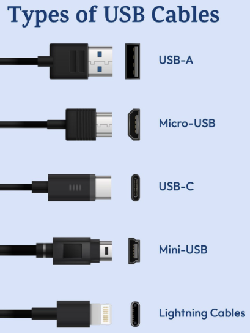
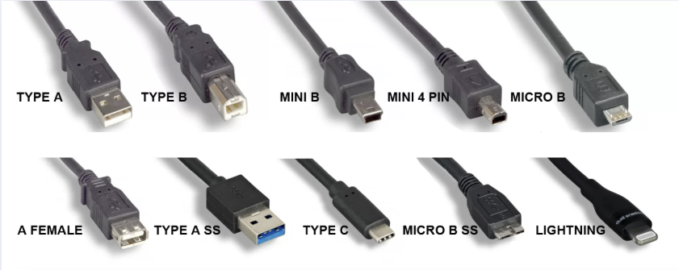

# Header
Different Types of USBs

USB cable assemblies are a cost-effective way to connect electronic devices. When first introduced, USB connectors and cable assemblies connected peripheral devices such as printers, scanners, cameras, and storage devices to computers. Now USB cable assemblies are everywhere and used for everything from programming systems in automobiles, connecting medical equipment, and charging cell phones for everyday use.
USB Assembly Types Including Mini USB, Micro USB and USB Standard
Technical Cable Applications is your one-stop shop for Off-The-Shelf USB cable assemblies. TCA offers a variety of USB 2.0 through USB 4 2.0 standard cables with various connector types in different lengths. This post is intended to be a comprehensive summary of the types of USB cables that are commercially available, what types we most commonly manufacture, and what the most cutting edge technology in the USB connector world is now.

USB Standards
The Universal Serial Bus standard released in 1996. The first standard, USB 1.0, was much faster than the typical serial or parallel connections available at the time. The USB standard evolved quickly. The following is a summary of major speed increases in the USB Standard, and how commonly these standards are used today.

Standard	Speed	Current Usage	Year Introduced
USB 1.0	12 Mbit/s: Full Speed (FS)	Rarely used today	1996
USB 2.0	480 Mbit/s: High Speed (HS)	Still used frequently as the minimum speed of cheaper USB-A cables	2000
USB 3.0	5 Gbit/s: SuperSpeed (SS)	Most popular USB edition for consumer grade electronics to this day	2008
USB 3.1	10 Gbit/s: SuperSpeed+ (SS+)	Mostly surpassed by 3.2	2013
USB 3.2	20 Gbit/s: SuperSpeed+ two-lane	Top tier USB cables prior to 2019 and still used far more frequently than 4 or 4 2.0	2017
USB 4	40 Gbit/s: two-lane	Becoming more common but still less used than 3.0 to 3.2	2019
USB 4 2.0	120 ⇄ 40 Gbit/s: asymmetric	Niche applications for pushing two data streams at once, not commonly used yet	2022
USB-A and USB-C Port Assembly
Connector Types
USB or Universal Serial Bus cables come with a variety of different connector types and the cable varies by the device requirements. The connector types include Type-A, Type-B, USB-C, Mini-A, Mini-B, Mini-AB, Micro-A, and Micro AB. There are also Super Speed versions of these connectors available. Here’s some info about the timeline of introductions, and how commonly these are seen today.

Connector	Variations	Current Applications	Year Introduced
Standard-A	1.0, 1.1, 2.0, SuperSpeed	The most common and cheapest USB connector	1996
Standard-B	SuperSpeed	Niche but used for hardware like printers or musical equipment	1996
Mini-A	n/a	Previously used for mobile phones but eclipsed by Micro B, then Type-C	2000
Mini-AB	n/a	Rarely used at any point, briefly used for HTC phones	2000
Mini-B	n/a	Previously used for digital cameras but eclipsed by Micro	2000
Micro-A	SuperSpeed	Used for host devices in some cases like desktop computers	2007
Micro-B	SuperSpeed	Used for Android phones. and mobile devices extensively prior to the introduction of Type-C	2007
Lightning	n/a	Apple mobile charger, now replaced by Type-C for new devices	2012
Type-C	n/a	The new standard for premium speed, charging, and both desktop and mobile applications	2014
Countless Configurations
Technical Cable Applications’ offerings include cables configured with all the connectors listed above and far more beyond. The company also has a large inventory of adapters for USB to Ethernet, USB to HDMI, USB to Serial, and more, plus full flexibility with crimping, tinning, and configuration for any complex assemblies.